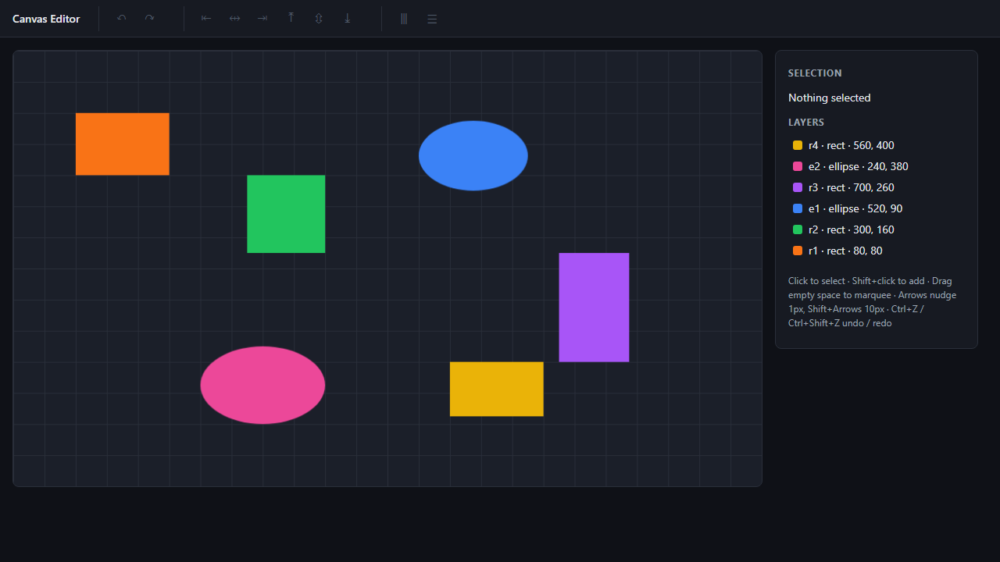
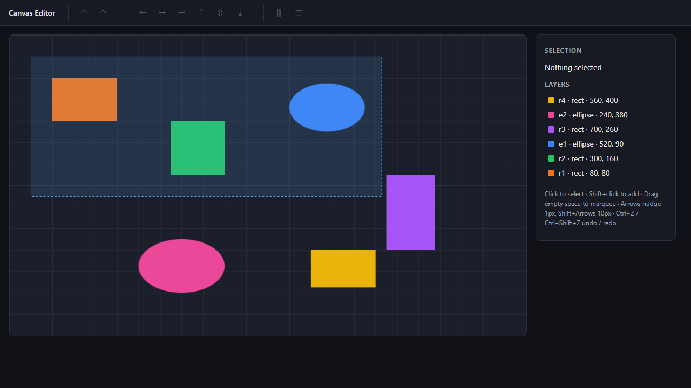
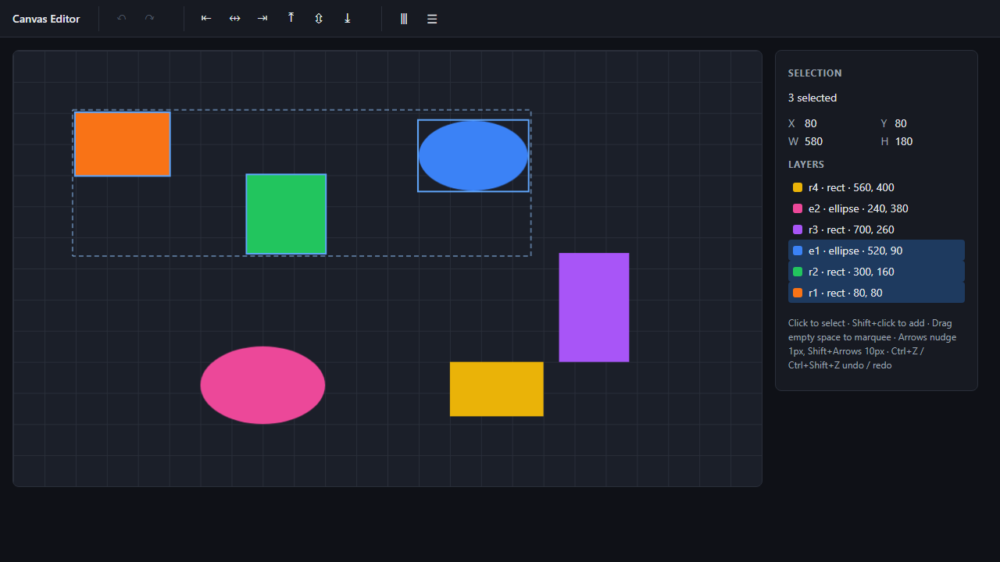
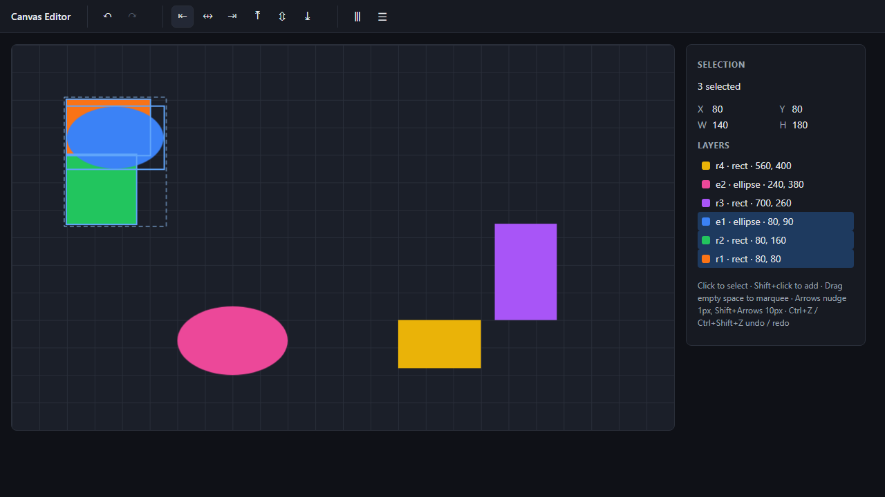
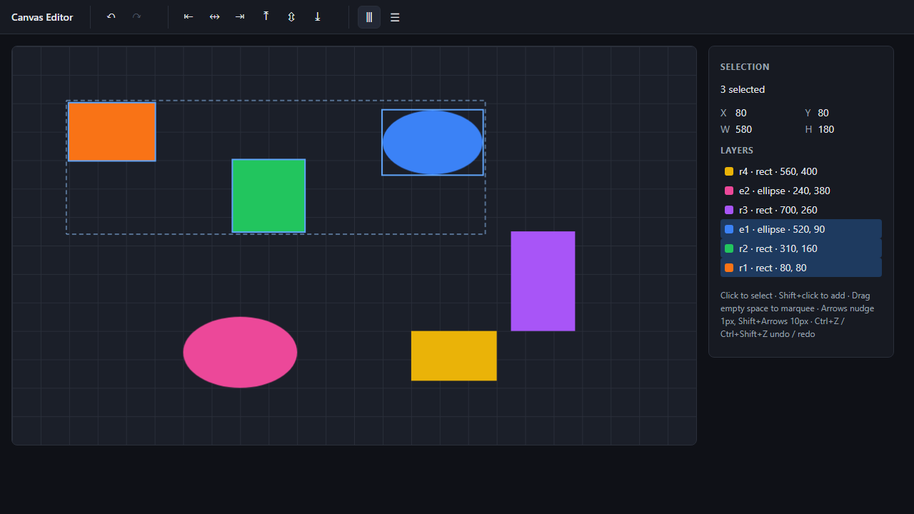
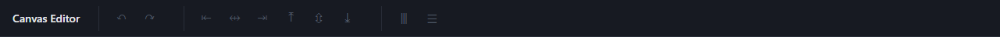
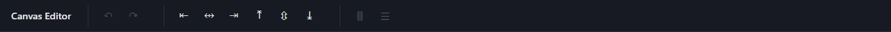
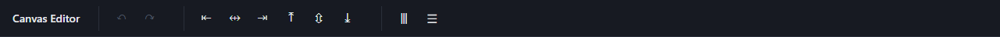

# Task: Marquee selection, alignment tools and keyboard nudge for a canvas editor

| | |
|---|---|
| **Difficulty** | Medium — ~6–8 h for an engineer comfortable with React + TypeScript |
| **Stack** | React 19, TypeScript, Zustand, HTML Canvas 2D, Vite |
| **Starting point** | branch `main` |
| **Reference implementation** | branch `solution` |
| **Grading** | `npm test` must pass (12 unit + 16 e2e), plus the manual checks in [VERIFICATION.md](VERIFICATION.md) |

## Context

The repository contains a small canvas editor. On `main` it can already:

- render a fixed document of six shapes (`src/editor/seed.ts`) on a `<canvas>`,
- select one shape by clicking it, add/remove shapes with **Shift+click**,
- drag the selection to move it, with undo/redo (`Ctrl+Z`, `Ctrl+Shift+Z`, toolbar buttons),
- show the selection's bounding box and a layer list in the right-hand inspector.

Designers reviewing the editor asked for three things that every layout tool has: a rubber-band ("marquee") selection, align/distribute buttons, and arrow-key nudging. The screenshots below were taken from the finished feature and are the visual spec. Where the images and this document disagree, **this document wins**.

## Visual material

| Starting state (`main`) | Marquee in progress |
|---|---|
|  |  |

| Marquee result — three shapes selected | After **Align left** |
|---|---|
|  |  |

| After **Distribute horizontally** | Toolbar: nothing / 2 / 3 selected |
|---|---|
|  |    |

## Files you will touch

| File | What changes |
|---|---|
| `src/editor/geometry.ts` | Implement `alignShapes` and `distributeShapes` (currently `throw`). Pure functions — no store access. |
| `src/editor/store.ts` | Add `marquee` state, `setMarquee`, `commitMarquee`, `nudgeSelected`, `alignSelected`, `distributeSelected`. |
| `src/editor/Canvas.tsx` | Marquee gesture on empty canvas + marquee rendering. |
| `src/editor/Toolbar.tsx` | Six align buttons and two distribute buttons with the `data-testid`s listed below. |
| `src/App.tsx` | Arrow-key nudge shortcuts. |

Do **not** change `src/editor/seed.ts`, the `window.__editor` test hook, or anything under `tests/`. The tests are the acceptance criteria; if you believe a test is wrong, say so in your submission instead of editing it.

## Step 1 — Marquee selection

**Expected behaviour**

1. Pressing the primary mouse button on an *empty* area of the canvas and dragging draws a rubber-band rectangle from the press point to the current pointer position. It is drawn as a dashed 1 px `#60a5fa` outline with a `rgba(96,165,250,0.15)` fill, above all shapes.
2. The rectangle must be normalised: dragging up-left yields the same box as dragging down-right between the same two points.
3. The marquee only starts once the pointer has moved at least **2 px** on either axis. A press-and-release without that movement is a plain click: it clears the selection (unless Shift is held, in which case nothing changes).
4. On release, the selection becomes every shape whose axis-aligned bounding box **intersects** the marquee box. Partial overlap counts; edge contact counts (a shape whose left edge is exactly at the box's right edge is selected). Fully containing a shape is *not* required.
5. With **Shift** held at press time, the hits are *added* to the existing selection (no duplicates, existing order preserved, new ids appended in document order).
6. Selected ids are stored in document order (the order of `shapes` in the store), regardless of drag direction.
7. A marquee never moves shapes and never creates an undo entry.

**State contract (read by the tests)**

```ts
marquee: Bounds | null                 // { x, y, w, h } in canvas px while dragging; null otherwise
setMarquee(rect: Bounds | null): void
commitMarquee(rect: Bounds, additive: boolean): void   // applies rule 4–6 and sets marquee = null
```

## Step 2 — Align & distribute toolbar

**Expected behaviour**

1. Add eight buttons to the toolbar, in this order, each with the given `data-testid` and an `aria-label`:

   | testid | label | enabled when |
   |---|---|---|
   | `align-left` | Align left | ≥ 2 selected |
   | `align-hcenter` | Align horizontal centers | ≥ 2 |
   | `align-right` | Align right | ≥ 2 |
   | `align-top` | Align top | ≥ 2 |
   | `align-vcenter` | Align vertical centers | ≥ 2 |
   | `align-bottom` | Align bottom | ≥ 2 |
   | `distribute-horizontal` | Distribute horizontally | ≥ 3 |
   | `distribute-vertical` | Distribute vertically | ≥ 3 |

   Otherwise the button has the `disabled` attribute.
2. **Align** moves each selected shape so that its chosen edge (or centre) coincides with the same edge (or centre) of the **selection's bounding box** — the box around all selected shapes before the operation. Unselected shapes never move. Sizes never change.
3. **Distribute** sorts the selected shapes by their position along the axis (ties broken by document order), keeps the first and last shape exactly where they are, and places the others so that the gap between each pair of neighbours is equal. Gap = (span − sum of sizes) / (n − 1). Gaps may be negative when shapes overlap; that is fine. Position on the other axis is untouched.
4. Every click is **one** undo step. Undo restores all affected shapes at once; redo re-applies them.
5. Implement the maths in `geometry.ts` with these signatures — the unit tests call them directly:

   ```ts
   alignShapes(shapes: readonly Shape[], mode: AlignMode): Shape[]       // < 2 shapes → copy of input
   distributeShapes(shapes: readonly Shape[], axis: Axis): Shape[]       // < 3 shapes → copy of input
   ```

   Both return a **new** array in the **input** order and never mutate their arguments.

Worked example (seed shapes `r1`, `r2`, `e1`): bounds are `x 80..660`, `y 80..260`. *Align left* → all `x = 80`. *Align vertical centers* → centre `y = 170`, so `r1.y = 130`, `r2.y = 120`, `e1.y = 125`. *Distribute horizontally* → span 580, widths 360, two gaps of 110 → `r2.x = 310`; `r1` and `e1` do not move.

## Step 3 — Keyboard nudge

**Expected behaviour**

1. With a non-empty selection, **←/→/↑/↓** move every selected shape by **1 px**; with **Shift** by **10 px**. The event's default (page scroll) is prevented.
2. Each key press is its own undo step, so pressing → three times and `Ctrl+Z` once moves the shape back by exactly 1 px.
3. With an empty selection the keys do nothing and add nothing to history.
4. Keys are ignored while focus is in an `<input>`, `<textarea>` or `contenteditable` element, and when Ctrl/Cmd is held (so browser shortcuts still work).

## Success criteria

A submission is **complete** when all of the following hold. Each item maps to a test or a step in [VERIFICATION.md](VERIFICATION.md), so a reviewer can check it without judgement calls.

| # | Criterion | Checked by |
|---|---|---|
| S1 | `npm run typecheck` exits 0 | CI / local |
| S2 | `npm run test:unit` — 12/12 pass | `tests/unit/geometry.test.ts` |
| S3 | `npm run test:e2e` — 16/16 pass | `tests/e2e/task.spec.ts` |
| S4 | Marquee box is drawn with the specified dash, stroke and fill colours | VERIFICATION M1 |
| S5 | Toolbar buttons are in the specified order and show tooltips with the labels above | VERIFICATION M2 |
| S6 | No test under `tests/` was modified (`git diff main -- tests` is empty) | review |
| S7 | `seed.ts` and the `window.__editor` hook are unchanged | review |

## Out of scope

Rotation, resizing, snapping, multi-touch, and persisting the document. Pixel-perfect matching of the screenshots is not required beyond S4.

## Notes for reviewers

- The tests assert on store state through `window.__editor`, not on pixels, so they are stable across fonts and GPUs. S4 is the only visual check and is done manually.
- Known trap: `distributeShapes` accumulates floating-point error when positions are computed by running sum. The unit test `handles four shapes` requires the last shape's coordinate to equal its input *exactly*; implementations must pin the outer shapes rather than trust the sum.
- Known trap: edge contact counts as intersection (Step 1, rule 4). A `<` instead of `<=` fails `a shape that is only partially inside the box is still selected` only in some positions, so the test suite includes a case that touches an edge exactly.
